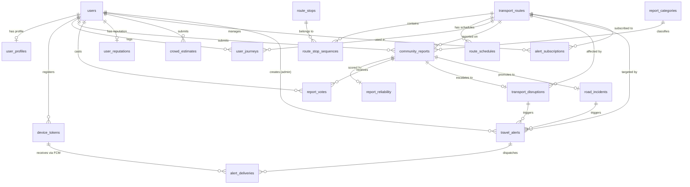

# TravelPulse LK — Database Architecture & Schema Design

**Project:** SE5104 Mini Project — Group 10  
**Database Engine:** MySQL 8.0+ (InnoDB)  
**Character Set / Collation:** `utf8mb4` / `utf8mb4_unicode_ci`  
**Status:** Verified Implementation — Complete Across All 4 Modules (Stage 7 Integrated)

---

## 1. Database Design Philosophy

1. **Third Normal Form (3NF):** Elimination of data redundancy while maintaining referential integrity across the four modules.
2. **Strict Foreign Key Constraints:** `ON DELETE CASCADE` is applied to strictly owned child entities (e.g. user profiles, report votes, sequences). `ON DELETE RESTRICT` or `ON DELETE SET NULL` is applied to critical audit entities (e.g. journeys, alerts).
3. **Optimized Spatial & Lookup Indexing:** High-frequency queries (e.g. bounding-box coordinates `(latitude, longitude)`, active status filters, route lookups) feature explicit composite indexes.
4. **Single Source of Truth:** Route IDs, Stop IDs, and User IDs are defined once by Nisal and referenced foreign-key style across Dumindi, Suneth, and Thimaya.

---

## 2. Entity-Relationship Overview

---

## 3. Data Dictionary by Module

### 3.1. Module 1: Nisal — User, Transport Route & Journey Management

#### Table 1: `users`
* **Owning Module:** Nisal
* **Purpose:** Core authentication and user account identity.
* **Columns:**

| Column Name | Data Type | Nullable | Default | Description / Constraints |
| :--- | :--- | :--- | :--- | :--- |
| `id` | BIGINT UNSIGNED | No | AUTO_INCREMENT | **Primary Key** |
| `name` | VARCHAR(100) | No | None | Commuter's display name |
| `email` | VARCHAR(150) | No | None | Unique login email (`UNIQUE KEY`) |
| `password_hash` | VARCHAR(255) | No | None | bcrypt hashed password |
| `phone_number` | VARCHAR(20) | Yes | NULL | Optional Sri Lankan phone number |
| `role` | ENUM('commuter', 'moderator', 'admin') | No | 'commuter' | Access control level |
| `is_active` | BOOLEAN | No | TRUE | Account suspension flag |
| `created_at` | TIMESTAMP | No | CURRENT_TIMESTAMP | Account creation time |
| `updated_at` | TIMESTAMP | No | CURRENT_TIMESTAMP ON UPDATE CURRENT_TIMESTAMP | Last profile update |

---

#### Table 2: `user_profiles`
* **Owning Module:** Nisal
* **Purpose:** Commuter transit preferences and home/work locations.
* **Columns:**

| Column Name | Data Type | Nullable | Default | Description / Constraints |
| :--- | :--- | :--- | :--- | :--- |
| `user_id` | BIGINT UNSIGNED | No | None | **Primary Key**, **FK** -> `users(id)` ON DELETE CASCADE |
| `home_stop_id` | BIGINT UNSIGNED | Yes | NULL | **FK** -> `route_stops(id)` ON DELETE SET NULL |
| `work_stop_id` | BIGINT UNSIGNED | Yes | NULL | **FK** -> `route_stops(id)` ON DELETE SET NULL |
| `preferred_transport_mode` | ENUM('bus', 'train', 'any') | No | 'any' | Commuter filter preference |
| `bio` | VARCHAR(255) | Yes | NULL | User bio or notes |
| `created_at` | TIMESTAMP | No | CURRENT_TIMESTAMP | Record creation |
| `updated_at` | TIMESTAMP | No | CURRENT_TIMESTAMP ON UPDATE CURRENT_TIMESTAMP | Record update |

---

#### Table 3: `device_tokens`
* **Owning Module:** Nisal
* **Purpose:** Stores Firebase Cloud Messaging (FCM) tokens for push notification dispatch.
* **Columns:**

| Column Name | Data Type | Nullable | Default | Description / Constraints |
| :--- | :--- | :--- | :--- | :--- |
| `id` | BIGINT UNSIGNED | No | AUTO_INCREMENT | **Primary Key** |
| `user_id` | BIGINT UNSIGNED | No | None | **FK** -> `users(id)` ON DELETE CASCADE |
| `fcm_token` | VARCHAR(255) | No | None | Unique FCM registration token (`UNIQUE KEY`) |
| `device_type` | ENUM('android', 'ios') | No | 'android' | Mobile operating system |
| `last_active_at` | TIMESTAMP | No | CURRENT_TIMESTAMP ON UPDATE CURRENT_TIMESTAMP | Last interaction time |

---

#### Table 4: `transport_routes`
* **Owning Module:** Nisal
* **Purpose:** Master catalog of public transit routes (bus lines, train routes).
* **Columns:**

| Column Name | Data Type | Nullable | Default | Description / Constraints |
| :--- | :--- | :--- | :--- | :--- |
| `id` | BIGINT UNSIGNED | No | AUTO_INCREMENT | **Primary Key** |
| `route_number` | VARCHAR(20) | No | None | E.g., '138', '100', 'KV-LINE' |
| `name` | VARCHAR(150) | No | None | Route name (e.g. 'Colombo Fort - Maharagama') |
| `transport_type` | ENUM('bus', 'train') | No | None | Transit modality |
| `operator` | VARCHAR(100) | Yes | NULL | E.g., 'SLTB', 'Private', 'Sri Lanka Railways' |
| `origin_city` | VARCHAR(100) | No | None | Starting terminal city |
| `destination_city` | VARCHAR(100) | No | None | Ending terminal city |
| `is_active` | BOOLEAN | No | TRUE | Route operational flag |
| `created_at` | TIMESTAMP | No | CURRENT_TIMESTAMP | Record creation |
| `updated_at` | TIMESTAMP | No | CURRENT_TIMESTAMP ON UPDATE CURRENT_TIMESTAMP | Record update |

---

#### Table 5: `route_stops`
* **Owning Module:** Nisal
* **Purpose:** Master catalog of physical stops and railway stations.
* **Columns:**

| Column Name | Data Type | Nullable | Default | Description / Constraints |
| :--- | :--- | :--- | :--- | :--- |
| `id` | BIGINT UNSIGNED | No | AUTO_INCREMENT | **Primary Key** |
| `name` | VARCHAR(150) | No | None | Stop/Station name (e.g., 'Bambalapitiya') |
| `stop_code` | VARCHAR(50) | Yes | NULL | Optional unique station/stop code (`UNIQUE KEY`) |
| `latitude` | DECIMAL(10, 8) | No | None | WGS84 Latitude |
| `longitude` | DECIMAL(11, 8) | No | None | WGS84 Longitude |
| `city` | VARCHAR(100) | No | None | Town/City name |
| `is_active` | BOOLEAN | No | TRUE | Stop active status |
| `created_at` | TIMESTAMP | No | CURRENT_TIMESTAMP | Record creation |

---

#### Table 6: `route_stop_sequences`
* **Owning Module:** Nisal
* **Purpose:** Ordered sequence of stops defining a complete transit route.
* **Columns:**

| Column Name | Data Type | Nullable | Default | Description / Constraints |
| :--- | :--- | :--- | :--- | :--- |
| `id` | BIGINT UNSIGNED | No | AUTO_INCREMENT | **Primary Key** |
| `route_id` | BIGINT UNSIGNED | No | None | **FK** -> `transport_routes(id)` ON DELETE CASCADE |
| `stop_id` | BIGINT UNSIGNED | No | None | **FK** -> `route_stops(id)` ON DELETE CASCADE |
| `stop_order` | SMALLINT UNSIGNED | No | None | Stop sequence number (1, 2, 3...) |
| `distance_from_prev_km` | DECIMAL(6, 2) | Yes | 0.00 | Kilometers from preceding stop |
| `est_minutes_from_prev` | SMALLINT UNSIGNED | Yes | 0 | Average travel minutes from preceding stop |
| *Constraints* | Unique: (`route_id`, `stop_order`), Unique: (`route_id`, `stop_id`) | | | |

---

#### Table 7: `route_schedules`
* **Owning Module:** Nisal
* **Purpose:** Timetables and scheduled departures for transit routes.
* **Columns:**

| Column Name | Data Type | Nullable | Default | Description / Constraints |
| :--- | :--- | :--- | :--- | :--- |
| `id` | BIGINT UNSIGNED | No | AUTO_INCREMENT | **Primary Key** |
| `route_id` | BIGINT UNSIGNED | No | None | **FK** -> `transport_routes(id)` ON DELETE CASCADE |
| `departure_time` | TIME | No | None | Scheduled start time |
| `arrival_time` | TIME | No | None | Scheduled terminus arrival time |
| `day_of_week` | ENUM('all', 'weekday', 'weekend', 'monday', 'tuesday', 'wednesday', 'thursday', 'friday', 'saturday', 'sunday') | No | 'all' | Schedule validity day |
| `trip_direction` | ENUM('outbound', 'inbound') | No | 'outbound' | Route direction |
| `is_active` | BOOLEAN | No | TRUE | Active timetable flag |

---

#### Table 8: `user_journeys`
* **Owning Module:** Nisal
* **Purpose:** History and active travel journeys logged by commuters.
* **Columns:**

| Column Name | Data Type | Nullable | Default | Description / Constraints |
| :--- | :--- | :--- | :--- | :--- |
| `id` | BIGINT UNSIGNED | No | AUTO_INCREMENT | **Primary Key** |
| `user_id` | BIGINT UNSIGNED | No | None | **FK** -> `users(id)` ON DELETE CASCADE |
| `route_id` | BIGINT UNSIGNED | No | None | **FK** -> `transport_routes(id)` ON DELETE RESTRICT |
| `origin_stop_id` | BIGINT UNSIGNED | No | None | **FK** -> `route_stops(id)` ON DELETE RESTRICT |
| `destination_stop_id` | BIGINT UNSIGNED | No | None | **FK** -> `route_stops(id)` ON DELETE RESTRICT |
| `start_time` | DATETIME | No | None | Journey departure timestamp |
| `end_time` | DATETIME | Yes | NULL | Journey arrival timestamp |
| `status` | ENUM('planned', 'in_progress', 'completed', 'cancelled') | No | 'planned' | Journey progress status |
| `created_at` | TIMESTAMP | No | CURRENT_TIMESTAMP | Log creation timestamp |

---

### 3.2. Module 2: Dumindi — Community Reporting & Transport Disruption Management

#### Table 9: `report_categories`
* **Owning Module:** Dumindi
* **Purpose:** Master taxonomy of disruption and incident types.
* **Columns:**

| Column Name | Data Type | Nullable | Default | Description / Constraints |
| :--- | :--- | :--- | :--- | :--- |
| `id` | SMALLINT UNSIGNED | No | AUTO_INCREMENT | **Primary Key** |
| `code` | VARCHAR(50) | No | None | Unique category code (e.g., 'BREAKDOWN', 'DELAY') |
| `name` | VARCHAR(100) | No | None | Human readable category name |
| `description` | VARCHAR(255) | Yes | NULL | Explanation of category scope |
| `default_severity` | ENUM('low', 'medium', 'high', 'critical') | No | 'medium' | Baseline severity |
| `is_active` | BOOLEAN | No | TRUE | Category availability |

---

#### Table 10: `community_reports`
* **Owning Module:** Dumindi
* **Purpose:** Primary user-submitted transit and road incident reports.
* **Columns:**

| Column Name | Data Type | Nullable | Default | Description / Constraints |
| :--- | :--- | :--- | :--- | :--- |
| `id` | BIGINT UNSIGNED | No | AUTO_INCREMENT | **Primary Key** |
| `user_id` | BIGINT UNSIGNED | No | None | **FK** -> `users(id)` ON DELETE CASCADE |
| `is_anonymous` | BOOLEAN | No | FALSE | Anonymous reporting flag (preserves ownership) |
| `category_id` | SMALLINT UNSIGNED | No | None | **FK** -> `report_categories(id)` ON DELETE RESTRICT |
| `route_id` | BIGINT UNSIGNED | Yes | NULL | **FK** -> `transport_routes(id)` ON DELETE SET NULL |
| `stop_id` | BIGINT UNSIGNED | Yes | NULL | **FK** -> `route_stops(id)` ON DELETE SET NULL |
| `latitude` | DECIMAL(10, 8) | No | None | Latitude of report location |
| `longitude` | DECIMAL(11, 8) | No | None | Longitude of report location |
| `location_description` | VARCHAR(255) | Yes | NULL | Free-text landmark/street name |
| `title` | VARCHAR(150) | No | None | Short report title |
| `description` | TEXT | No | None | Detailed commuter observations |
| `disruption_reason` | VARCHAR(100) | Yes | NULL | Operational reason (breakdown, flood, strike, etc.) |
| `media_url` | VARCHAR(255) | Yes | NULL | Cloud URL of attached evidence photo |
| `status` | ENUM('submitted', 'verified', 'disputed', 'resolved', 'rejected', 'expired') | No | 'submitted' | Lifecycle status |
| `created_at` | TIMESTAMP | No | CURRENT_TIMESTAMP | Submission timestamp |
| `resolved_at` | DATETIME | Yes | NULL | Timestamp when issue ended |

---

#### Table 11: `transport_disruptions`
* **Owning Module:** Dumindi
* **Purpose:** Operational public transit disruptions affecting specific transit routes.
* **Columns:**

| Column Name | Data Type | Nullable | Default | Description / Constraints |
| :--- | :--- | :--- | :--- | :--- |
| `id` | BIGINT UNSIGNED | No | AUTO_INCREMENT | **Primary Key** |
| `originating_report_id`| BIGINT UNSIGNED | Yes | NULL | **FK** -> `community_reports(id)` ON DELETE SET NULL |
| `route_id` | BIGINT UNSIGNED | No | None | **FK** -> `transport_routes(id)` ON DELETE CASCADE |
| `affected_stop_id` | BIGINT UNSIGNED | Yes | NULL | **FK** -> `route_stops(id)` ON DELETE SET NULL |
| `disruption_type` | VARCHAR(50) | No | None | 'Breakdown', 'Strike', 'Track Failure' |
| `severity` | ENUM('low', 'medium', 'high', 'critical') | No | 'medium' | Operational impact |
| `headline` | VARCHAR(200) | No | None | Summary alert headline |
| `details` | TEXT | No | None | Full operational advisory |
| `status` | ENUM('active', 'cleared', 'archived') | No | 'active' | Current operational status |
| `started_at` | DATETIME | No | None | Start time of disruption |
| `estimated_cleared_at`| DATETIME | Yes | NULL | Projected resolution time |
| `cleared_at` | DATETIME | Yes | NULL | Actual clearance time |
| `created_at` | TIMESTAMP | No | CURRENT_TIMESTAMP | Record creation |

---

### 3.3. Module 3: Suneth — Crowd Intelligence & Report Reliability Engine

#### Table 12: `user_reputations`
* **Owning Module:** Suneth
* **Purpose:** Trustworthiness scoring for commuters based on past contributions.
* **Columns:**

| Column Name | Data Type | Nullable | Default | Description / Constraints |
| :--- | :--- | :--- | :--- | :--- |
| `user_id` | BIGINT UNSIGNED | No | None | **Primary Key**, **FK** -> `users(id)` ON DELETE CASCADE |
| `reputation_score` | DECIMAL(5, 2) | No | 10.00 | Score between 0.00 and 100.00 |
| `total_reports_submitted`| INT UNSIGNED | No | 0 | Count of all reports made |
| `verified_reports_count` | INT UNSIGNED | No | 0 | Count of reports verified |
| `rejected_reports_count` | INT UNSIGNED | No | 0 | Count of reports debunked/spam |
| `total_votes_cast` | INT UNSIGNED | No | 0 | Count of votes submitted on reports |
| `updated_at` | TIMESTAMP | No | CURRENT_TIMESTAMP ON UPDATE CURRENT_TIMESTAMP | Last recalculation |

---

#### Table 13: `report_votes`
* **Owning Module:** Suneth
* **Purpose:** Peer confirmation and debunking votes on community reports.
* **Columns:**

| Column Name | Data Type | Nullable | Default | Description / Constraints |
| :--- | :--- | :--- | :--- | :--- |
| `id` | BIGINT UNSIGNED | No | AUTO_INCREMENT | **Primary Key** |
| `report_id` | BIGINT UNSIGNED | No | None | **FK** -> `community_reports(id)` ON DELETE CASCADE |
| `user_id` | BIGINT UNSIGNED | No | None | **FK** -> `users(id)` ON DELETE CASCADE |
| `vote_type` | ENUM('upvote', 'downvote', 'confirm_resolved') | No | None | Type of peer verification |
| `created_at` | TIMESTAMP | No | CURRENT_TIMESTAMP | Vote submission time |
| *Constraints* | Unique: (`report_id`, `user_id`) (one vote per user per report) | | | |

---

#### Table 14: `report_reliability`
* **Owning Module:** Suneth
* **Purpose:** Dynamic algorithmic reliability score for each report.
* **Columns:**

| Column Name | Data Type | Nullable | Default | Description / Constraints |
| :--- | :--- | :--- | :--- | :--- |
| `report_id` | BIGINT UNSIGNED | No | None | **Primary Key**, **FK** -> `community_reports(id)` ON DELETE CASCADE |
| `reliability_score` | DECIMAL(5, 2) | No | 0.00 | Calculated reliability percentage (0 - 100%) |
| `confidence_status` | ENUM('unverified', 'plausible', 'verified', 'disputed', 'rejected') | No | 'unverified' | Categorical assessment |
| `upvotes_count` | INT UNSIGNED | No | 0 | Total positive confirmations |
| `downvotes_count` | INT UNSIGNED | No | 0 | Total negative votes |
| `corroboration_count`| INT UNSIGNED | No | 0 | Nearby reports matching category & time |
| `last_calculated_at`| TIMESTAMP | No | CURRENT_TIMESTAMP ON UPDATE CURRENT_TIMESTAMP | Score calculation time |

---

#### Table 15: `crowd_estimates`
* **Owning Module:** Suneth
* **Purpose:** Fast raw crowd observations reported by commuters.
* **Columns:**

| Column Name | Data Type | Nullable | Default | Description / Constraints |
| :--- | :--- | :--- | :--- | :--- |
| `id` | BIGINT UNSIGNED | No | AUTO_INCREMENT | **Primary Key** |
| `user_id` | BIGINT UNSIGNED | No | None | **FK** -> `users(id)` ON DELETE CASCADE |
| `route_id` | BIGINT UNSIGNED | Yes | NULL | **FK** -> `transport_routes(id)` ON DELETE CASCADE |
| `stop_id` | BIGINT UNSIGNED | Yes | NULL | **FK** -> `route_stops(id)` ON DELETE CASCADE |
| `crowd_level` | ENUM('empty', 'moderate', 'crowded', 'very_crowded') | No | None | Subjective crowd level |
| `passenger_wait_time_minutes` | SMALLINT UNSIGNED | Yes | NULL | Estimated wait time in minutes |
| `reported_at` | TIMESTAMP | No | CURRENT_TIMESTAMP | Timestamp of observation |

---

#### Table 16: `crowd_aggregations`
* **Owning Module:** Suneth
* **Purpose:** Time-windowed consensus crowd metrics for stops and routes. Enforces relational integrity using dual nullable foreign keys and a MySQL 8.0+ `CHECK` constraint.
* **Columns:**

| Column Name | Data Type | Nullable | Default | Description / Constraints |
| :--- | :--- | :--- | :--- | :--- |
| `id` | BIGINT UNSIGNED | No | AUTO_INCREMENT | **Primary Key** |
| `route_id` | BIGINT UNSIGNED | Yes | NULL | **FK** -> `transport_routes(id)` ON DELETE CASCADE |
| `stop_id` | BIGINT UNSIGNED | Yes | NULL | **FK** -> `route_stops(id)` ON DELETE CASCADE |
| `time_slot` | DATETIME | No | None | 15-minute time bucket (e.g. '2026-11-09 17:30:00') |
| `aggregated_crowd_level` | ENUM('empty', 'moderate', 'crowded', 'very_crowded') | No | None | Statistical mode/median crowd |
| `sample_count` | INT UNSIGNED | No | 1 | Number of data points in window |
| `confidence_score`| DECIMAL(5, 2) | No | 0.00 | Statistical confidence score |
| `last_updated_at` | TIMESTAMP | No | CURRENT_TIMESTAMP ON UPDATE CURRENT_TIMESTAMP | Aggregation timestamp |
| *Constraints* | **CHECK**: `((route_id IS NOT NULL AND stop_id IS NULL) OR (route_id IS NULL AND stop_id IS NOT NULL))` | | | Guarantees exactly one parent entity is populated |

---

### 3.4. Module 4: Thimaya — Road Conditions, Maps & Travel Alert System

#### Table 17: `road_incidents`
* **Owning Module:** Thimaya
* **Purpose:** Physical road hazards and condition markers rendered on Google Maps.
* **Columns:**

| Column Name | Data Type | Nullable | Default | Description / Constraints |
| :--- | :--- | :--- | :--- | :--- |
| `id` | BIGINT UNSIGNED | No | AUTO_INCREMENT | **Primary Key** |
| `source_report_id` | BIGINT UNSIGNED | Yes | NULL | **FK** -> `community_reports(id)` ON DELETE SET NULL |
| `incident_type` | ENUM('pothole', 'flooding', 'landslide', 'road_closure', 'accident', 'congestion', 'traffic_lights_down') | No | None | Specific road hazard classification |
| `latitude` | DECIMAL(10, 8) | No | None | Geographic latitude |
| `longitude` | DECIMAL(11, 8) | No | None | Geographic longitude |
| `address_text` | VARCHAR(255) | Yes | NULL | Road or junction name |
| `severity` | ENUM('low', 'medium', 'high', 'critical') | No | 'medium' | Severity level |
| `radius_meters` | INT UNSIGNED | No | 100 | Affected hazard zone radius |
| `is_active` | BOOLEAN | No | TRUE | Active on map flag |
| `verified_by_user_id`| BIGINT UNSIGNED | Yes | NULL | **FK** -> `users(id)` ON DELETE SET NULL |
| `start_time` | DATETIME | No | None | Incident start time |
| `end_time` | DATETIME | Yes | NULL | Incident resolution time |
| `created_at` | TIMESTAMP | No | CURRENT_TIMESTAMP | Record creation |
| `updated_at` | TIMESTAMP | No | CURRENT_TIMESTAMP ON UPDATE CURRENT_TIMESTAMP | Last record update |

---

#### Table 18: `travel_alerts`
* **Owning Module:** Thimaya
* **Purpose:** Broadcast travel advisories sent to commuters via in-app feeds and push notifications.
* **Columns:**

| Column Name | Data Type | Nullable | Default | Description / Constraints |
| :--- | :--- | :--- | :--- | :--- |
| `id` | BIGINT UNSIGNED | No | AUTO_INCREMENT | **Primary Key** |
| `title` | VARCHAR(150) | No | None | Short alert headline |
| `message` | TEXT | No | None | Detailed advisory message |
| `alert_type` | ENUM('transport_disruption', 'road_condition', 'weather_emergency', 'security') | No | None | Alert category |
| `severity` | ENUM('info', 'warning', 'critical') | No | 'info' | Priority level |
| `related_disruption_id`| BIGINT UNSIGNED | Yes | NULL | **FK** -> `transport_disruptions(id)` ON DELETE SET NULL |
| `related_incident_id` | BIGINT UNSIGNED | Yes | NULL | **FK** -> `road_incidents(id)` ON DELETE SET NULL |
| `target_route_id` | BIGINT UNSIGNED | Yes | NULL | **FK** -> `transport_routes(id)` ON DELETE SET NULL |
| `target_latitude` | DECIMAL(10, 8) | Yes | NULL | Center latitude for geo-fenced alert |
| `target_longitude` | DECIMAL(11, 8) | Yes | NULL | Center longitude for geo-fenced alert |
| `target_radius_km` | DECIMAL(5, 2) | Yes | NULL | Radius for geo-fenced alert |
| `status` | ENUM('active', 'expired', 'cancelled') | No | 'active' | Alert broadcast status |
| `created_by` | BIGINT UNSIGNED | No | None | **FK** -> `users(id)` ON DELETE RESTRICT (admin/system) |
| `created_at` | TIMESTAMP | No | CURRENT_TIMESTAMP | Broadcast timestamp |
| `expires_at` | DATETIME | Yes | NULL | Automatic expiration timestamp |

---

#### Table 19: `alert_subscriptions`
* **Owning Module:** Thimaya
* **Purpose:** User alert notification preferences (route subscriptions and location radii).
* **Columns:**

| Column Name | Data Type | Nullable | Default | Description / Constraints |
| :--- | :--- | :--- | :--- | :--- |
| `id` | BIGINT UNSIGNED | No | AUTO_INCREMENT | **Primary Key** |
| `user_id` | BIGINT UNSIGNED | No | None | **FK** -> `users(id)` ON DELETE CASCADE |
| `subscription_type`| ENUM('route', 'geo_radius', 'all_critical') | No | 'route' | Filter strategy |
| `route_id` | BIGINT UNSIGNED | Yes | NULL | **FK** -> `transport_routes(id)` ON DELETE CASCADE |
| `center_latitude` | DECIMAL(10, 8) | Yes | NULL | User-specified latitude |
| `center_longitude`| DECIMAL(11, 8) | Yes | NULL | User-specified longitude |
| `radius_km` | DECIMAL(5, 2) | Yes | NULL | Alert radius threshold |
| `is_active` | BOOLEAN | No | TRUE | Subscription toggle |
| `created_at` | TIMESTAMP | No | CURRENT_TIMESTAMP | Subscription timestamp |

---

#### Table 20: `alert_deliveries`
* **Owning Module:** Thimaya
* **Purpose:** Audit log of Firebase Cloud Messaging push notification dispatches.
* **Columns:**

| Column Name | Data Type | Nullable | Default | Description / Constraints |
| :--- | :--- | :--- | :--- | :--- |
| `id` | BIGINT UNSIGNED | No | AUTO_INCREMENT | **Primary Key** |
| `alert_id` | BIGINT UNSIGNED | No | None | **FK** -> `travel_alerts(id)` ON DELETE CASCADE |
| `user_id` | BIGINT UNSIGNED | No | None | **FK** -> `users(id)` ON DELETE CASCADE |
| `device_token_id` | BIGINT UNSIGNED | Yes | NULL | **FK** -> `device_tokens(id)` ON DELETE SET NULL |
| `delivery_status` | ENUM('pending', 'sent', 'failed') | No | 'pending' | FCM send outcome |
| `fcm_message_id` | VARCHAR(255) | Yes | NULL | Upstream FCM response identifier |
| `delivered_at` | DATETIME | Yes | NULL | Dispatch timestamp |
| `created_at` | TIMESTAMP | No | CURRENT_TIMESTAMP | Audit creation timestamp |

---

## 4. Key Indexes for Query Performance

| Table | Index Name | Indexed Columns | Justification / Usage |
| :--- | :--- | :--- | :--- |
| `community_reports` | `idx_reports_coords` | `(latitude, longitude)` | High-frequency radius searching on map view |
| `community_reports` | `idx_reports_route_status` | `(route_id, status)` | Filter active reports per bus/train route |
| `road_incidents` | `idx_incidents_coords_active` | `(latitude, longitude, is_active)` | Bounding-box queries for map rendering viewport |
| `crowd_estimates` | `idx_crowd_route_stop_time` | `(route_id, stop_id, reported_at)` | Time-window aggregation queries (last 30 minutes) |
| `user_journeys` | `idx_journeys_user_status` | `(user_id, status)` | Fast loading of commuter history & active journey |
| `device_tokens` | `idx_tokens_user` | `(user_id)` | Fast lookup of user FCM tokens during alert broadcast |
| `travel_alerts` | `idx_alerts_status_expires` | `(status, expires_at)` | Fast retrieval of active, unexpired alerts |

