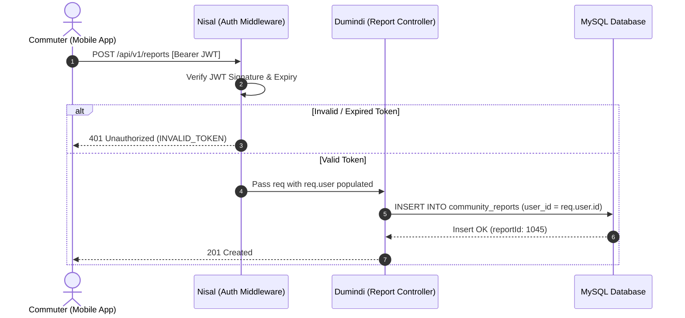
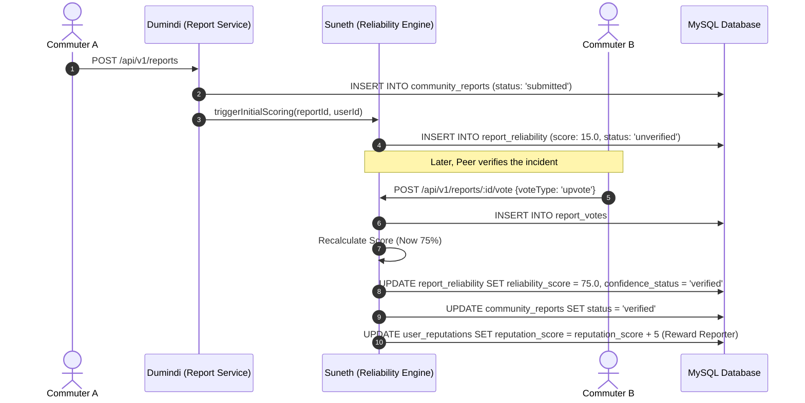
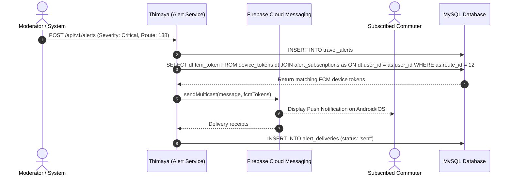

# TravelPulse LK — Module Integration & Cross-Cutting Architecture

**Project:** SE5104 Mini Project — Group 10  
**Status:** Proposal for Team Review

---

## 1. Overview & Integration Principles

To prevent spaghetti code, tight coupling, and logic duplication across the four development streams, TravelPulse LK establishes strict boundaries:

1. **Shared Authentication Middleware:** Nisal provides a central JWT authenticator mounted on all protected endpoints.
2. **Master Data Canonicalization:** Nisal is the sole producer of Route and Stop data; Dumindi, Suneth, and Thimaya consume these via relational foreign keys and shared database queries.
3. **Event & Service-Driven Integration Pipeline:**
   * **Dumindi** ingests raw community reports.
   * **Suneth** recalculates reliability and user reputation upon receiving votes or new reports.
   * **Thimaya** promotes verified road-condition reports onto Google Maps and triggers targeted Firebase Cloud Messaging (FCM) push notifications.

---

## 2. Cross-Module Architectural Workflows

### 2.1. Shared Authentication Flow (Nisal -> All Modules)

1. Commuter signs in via `/api/v1/auth/login`.
2. **Nisal's AuthService** checks bcrypt password hash in `users` and issues a signed JSON Web Token (JWT) containing `{ userId, email, role }`.
3. The mobile application stores this token securely in `flutter_secure_storage`.
4. Every subsequent API call to any module (Dumindi, Suneth, Thimaya) passes `Authorization: Bearer <JWT>`.
5. **Shared Auth Middleware (`backend/src/middleware/auth.middleware.js`)**:
   * Validates token signature and expiration.
   * Attaches payload to Express request object: `req.user = { id: 1, email: "...", role: "commuter" }`.
6. Role-based access control (`backend/src/middleware/role.middleware.js`) intercepts endpoints requiring `'moderator'` or `'admin'` privilege.

---

### 2.2. Master Transit Network Sharing (Nisal -> All Modules)

* **Problem:** Every module needs Route and Stop details (e.g. Dumindi for tagging disruptions to Route 138, Suneth for crowd levels at Bambalapitiya station, Thimaya for plotting bus routes on Google Maps).
* **Solution:**
  * Nisal owns `transport_routes`, `route_stops`, and `route_stop_sequences`.
  * Other modules reference `route_id` and `stop_id` as foreign keys without maintaining duplicate route tables.
  * In the mobile app, Dumindi's reporting screen and Suneth's crowd reporting modal reuse Nisal's `RouteSelectionWidget` and `StopDropdownWidget`.

---

### 2.3. End-to-End Report Submission & Reliability Scoring (Dumindi -> Suneth)

1. Commuter notices an overturned lorry or broken bus and submits a report via Dumindi's interface.
2. The report is written to `community_reports` with `status: 'submitted'`.
3. Dumindi's service immediately initializes Suneth's `report_reliability` entry with a baseline score based on the reporting user's existing `reputation_score` from `user_reputations`.
4. Nearby commuters view the report and cast votes (`upvote` or `downvote`) via Suneth's `/api/v1/reports/:id/vote`.
5. **Suneth's Reliability Engine**:
   * Calculates weighted reliability score:
     $$\text{Score} = w_1 \cdot \text{VoteRatio} + w_2 \cdot \text{ReporterReputation} + w_3 \cdot \text{CorroborationCount}$$
   * If $\text{Score} \ge 70\%$ and $\text{Upvotes} \ge 3$, report status automatically transitions to `verified`.
   * If $\text{Downvotes} \ge 5$ and $\text{VoteRatio} < 30\%$, status transitions to `disputed` or `rejected`.
   * When a report is verified, the reporter's `reputation_score` in `user_reputations` is awarded bonus points.

---

### 2.4. Incident Promotion, Map Rendering & FCM Alert Dispatch (Suneth -> Thimaya)

1. **Map Display:** Thimaya's Google Maps viewport makes periodic queries to `/api/v1/maps/incidents` and `/api/v1/reports?status=verified` to render color-coded markers.
2. **Alert Triggering:**
   * When an incident is flagged with high or critical severity (e.g. major road closure, train strike), a moderator or automated trigger creates a record in `travel_alerts`.
3. **Push Notification Dispatch:**
   * Thimaya's `AlertService`:
     1. Queries `alert_subscriptions` to identify users subscribed to the affected `route_id` or located within `radius_km` of the incident coordinate.
     2. Joins `device_tokens` (Nisal's table) to retrieve active FCM tokens for those matched users.
     3. Batches tokens and dispatches push notifications via Firebase Admin SDK.
     4. Logs the delivery result in `alert_deliveries`.

---

## 3. Communication Patterns to Avoid Business Logic Duplication

1. **Internal Service Invocations over HTTP Re-entry:**
   * Modules running within the same Node.js process call each other's service layer directly (e.g., `sunethService.recalculateReportScore(reportId)`), rather than making internal HTTP roundtrips.
2. **Strict Data Boundary Ownership:**
   * A module may read foreign tables via read-only SQL queries or exported service helper functions.
   * A module **must not** directly execute `UPDATE` or `DELETE` on tables owned by another module. Updates must go through the owning module's service method.
3. **Database Transaction Safety:**
   * In operations involving multiple tables (e.g., creating a report and initializing its reliability record), services must accept and propagate a MySQL connection transaction handle (`connection.beginTransaction()`, `connection.commit()`, `connection.rollback()`).

