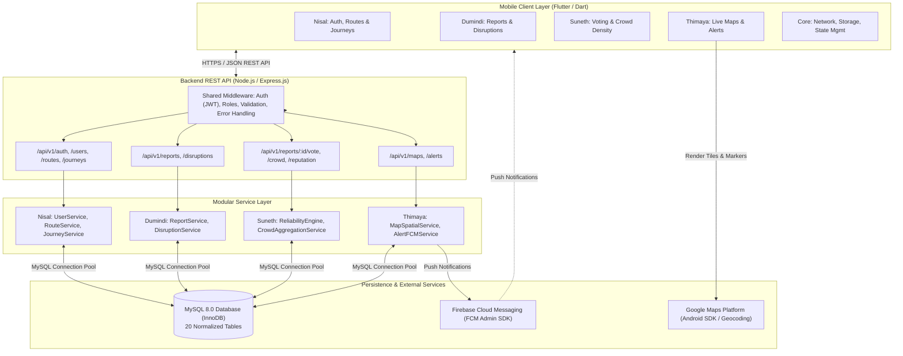

# TravelPulse LK — Overall System Architecture & Engineering Blueprint

**Project:** SE5104 Mini Project — Group 10  
**Application:** TravelPulse LK  
**Status:** Proposal for Team Review

---

## 1. System Overview

TravelPulse LK is a smart community-based transit and road condition mobile platform tailored for the Sri Lankan transportation ecosystem. It connects commuters, transit operators, and road users to provide:
1. Master public transport schedules, routes, and journey logs (**Nisal**).
2. Crowdsourced incident and disruption reporting (**Dumindi**).
3. Algorithmic peer-validation, fraud prevention, and real-time crowd estimation (**Suneth**).
4. Google Maps live hazard overlays and geo-fenced travel push alerts via Firebase (**Thimaya**).

---

## 2. High-Level Architecture Diagram



---

## 3. Technology Stack & Justification

| Layer / Component | Technology | Rationale & Configuration |
| :--- | :--- | :--- |
| **Mobile App** | **Flutter (Dart 3.x)** | Cross-platform code base (Android/iOS) with fast reactive UI rendering and native Google Maps plugin support. |
| **Backend API** | **Node.js + Express.js** | Lightweight, asynchronous non-blocking event-driven I/O, ideal for I/O-bound crowd reporting and REST communication. |
| **Database** | **MySQL 8.0 (InnoDB)** | ACID compliant relational database enforcing foreign key constraints, high concurrency, and reliable transactions. |
| **Authentication** | **JWT & bcrypt** | Stateless authentication using encrypted JSON Web Tokens and bcrypt salt hashing for passwords. |
| **Maps & GPS** | **Google Maps Flutter Plugin** | High-fidelity interactive mapping, custom markers, polylines for transit routes, and device GPS geolocation. |
| **Push Notifications** | **Firebase Cloud Messaging (FCM)**| Reliable cross-platform push notifications with device token management and topic/direct messaging. |

---

## 4. Repository & File Organization Blueprint

To ensure that git feature branches for each member merge cleanly into `develop` without conflicts, the existing directory structure is strictly maintained and partitioned by module:

```
travelpulse-lk/
├── .gitignore
├── README.md
├── backend/
│   ├── package.json
│   ├── src/
│   │   ├── server.js                      # Application entrypoint & HTTP listener
│   │   ├── app.js                         # Express configuration, cors, master router
│   │   ├── config/
│   │   │   ├── db.config.js               # mysql2 connection pool
│   │   │   ├── jwt.config.js              # JWT secrets and token options
│   │   │   └── firebase.config.js         # Firebase Admin SDK initialization
│   │   ├── middleware/
│   │   │   ├── auth.middleware.js         # JWT extraction & verification (Nisal)
│   │   │   ├── role.middleware.js         # Role authorization guard (Nisal)
│   │   │   ├── validate.middleware.js     # Request body validator
│   │   │   └── error.middleware.js        # Global error and exception handler
│   │   ├── routes/
│   │   │   ├── index.js                   # Master router combining all sub-routers
│   │   │   ├── nisal.routes.js            # Auth, users, routes, journeys
│   │   │   ├── dumindi.routes.js          # Reports, categories, disruptions
│   │   │   ├── suneth.routes.js           # Voting, reliability, crowd estimation
│   │   │   └── thimaya.routes.js          # Map incidents, travel alerts, subscriptions
│   │   ├── controllers/
│   │   │   ├── nisal/                     # AuthController, RouteController, JourneyController
│   │   │   ├── dumindi/                   # ReportController, DisruptionController
│   │   │   ├── suneth/                    # ReliabilityController, CrowdController
│   │   │   └── thimaya/                   # MapController, AlertController
│   │   └── services/
│   │       ├── nisal/                     # UserService, RouteService, JourneyService
│   │       ├── dumindi/                   # ReportService, DisruptionService
│   │       ├── suneth/                    # ReliabilityEngine, CrowdAggregationService
│   │       └── thimaya/                   # MapSpatialService, PushNotificationService
├── database/
│   ├── schema/
│   │   ├── 01_nisal_user_transport_schema.sql
│   │   ├── 02_dumindi_community_reports_schema.sql
│   │   ├── 03_suneth_crowd_reliability_schema.sql
│   │   ├── 04_thimaya_road_alerts_schema.sql
│   │   └── full_schema.sql                # Complete consolidated creation script
│   ├── migrations/
│   │   ├── 20261109_001_create_users_routes.sql
│   │   ├── 20261109_002_create_reports_disruptions.sql
│   │   ├── 20261109_003_create_crowd_reliability.sql
│   │   └── 20261109_004_create_incidents_alerts.sql
│   └── seeds/
│       ├── 01_users_routes_seed.sql       # Test users, Sri Lankan routes (138, 100, etc.)
│       ├── 02_report_categories_seed.sql  # Standard categories (breakdown, delay, flood)
│       ├── 03_crowd_seed.sql              # Initial crowd and reputation metrics
│       └── 04_road_incidents_seed.sql     # Sample Colombo hazards and alerts
├── docs/
│   ├── module-ownership.md
│   ├── database-design.md
│   ├── api-contracts.md
│   ├── module-integration.md
│   └── system_architecture.md
└── mobile-app/
    ├── pubspec.yaml
    └── lib/
        ├── main.dart                      # Flutter app entry point
        ├── app.dart                       # MaterialApp theme and router config
        ├── core/                          # Cross-cutting utilities
        │   ├── constants/                 # App colors, API endpoints, assets
        │   ├── network/                   # HTTP client wrapper with auth interceptor
        │   ├── storage/                   # Secure storage for auth token
        │   └── widgets/                   # Reusable buttons, inputs, loading dialogs
        └── modules/                       # Member-isolated module folders
            ├── nisal/                     # Auth views, Route Search, Journey Log
            ├── dumindi/                   # Report submission, Disruption feed
            ├── suneth/                    # Voting buttons, Reliability badge, Crowd widgets
            └── thimaya/                   # Google Map view, Alert inbox & notifications
```

---

## 5. Non-Functional Engineering Requirements

1. **Academic Feasibility & Simplicity:**
   * Architecture avoids distributed microservices or Kafka brokers. A modular monolith using Node.js/Express and MySQL provides immediate local setup, zero hosting overhead during development, and rapid debugging.
2. **Data Consistency & Integrity:**
   * InnoDB transaction safety is strictly applied during multi-step writes (e.g., report submission + initial reliability initialization).
3. **Security:**
   * Passwords hashed with bcrypt (salt rounds: 10).
   * JWT tokens signed using HMAC SHA-256 with environment-based secret (`process.env.JWT_SECRET`).
   * SQL injection prevention via parameterized SQL queries in `mysql2/promise`.
4. **Performance & Scalability:**
   * Connection pooling via `mysql2.createPool({ connectionLimit: 10 })`.
   * B-tree composite indexing on frequent query coordinates `(latitude, longitude)` and foreign keys.

---

## 6. Review Checklist Prior to Code Generation

- [ ] All four members confirm agreement on module ownership and table splits.
- [ ] Database schema foreign key relationships reviewed and approved.
- [ ] API URL structures and JSON envelopes approved for mobile integration.
- [ ] Cross-module service interaction flow approved.
- [ ] Ready to proceed with database DDL scripts and starter migrations upon approval.

